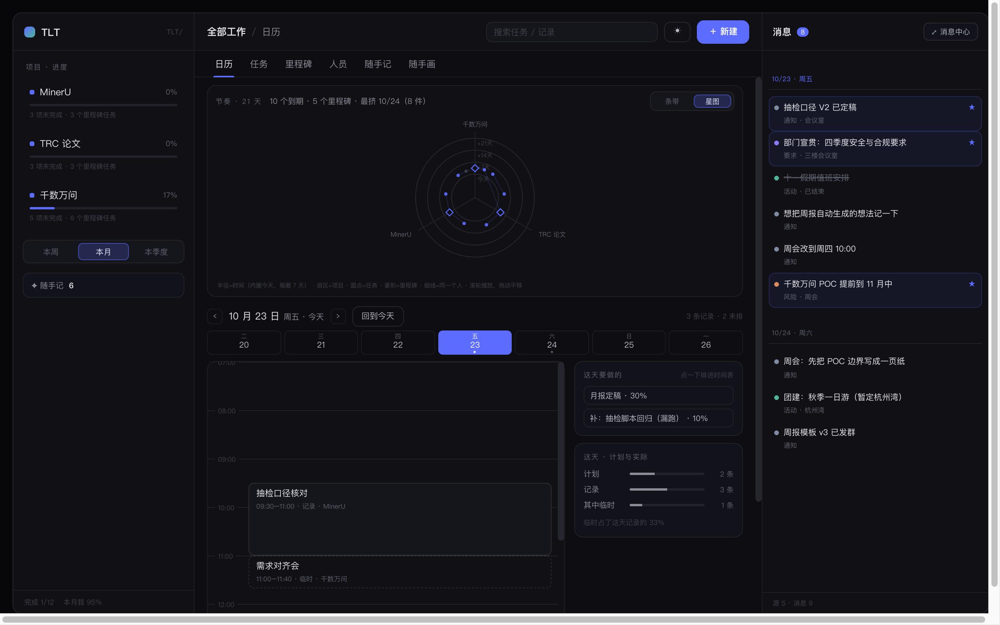
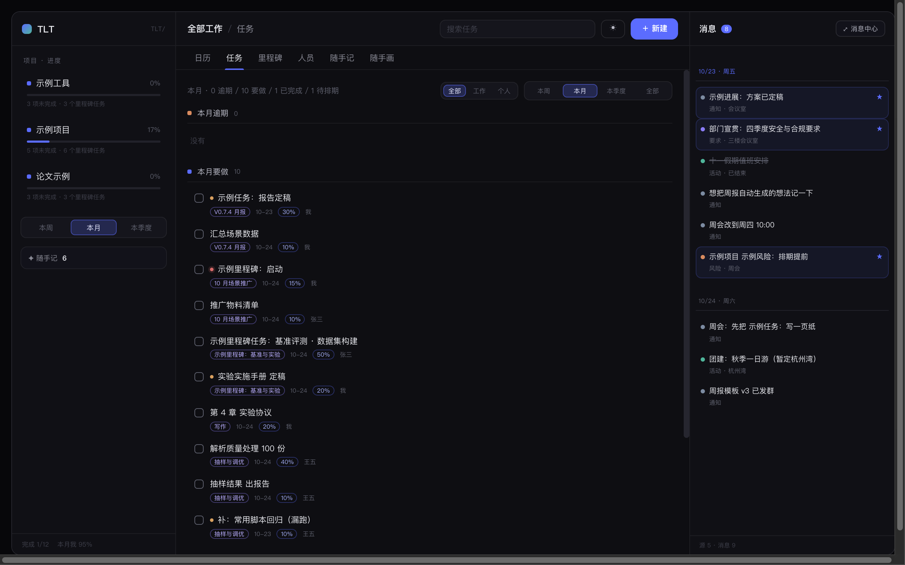
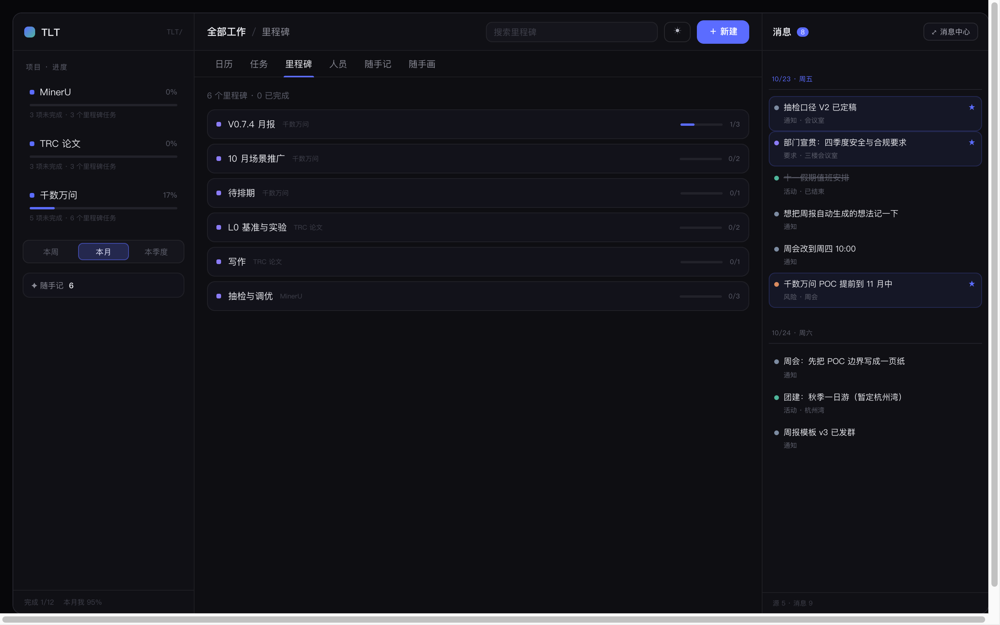
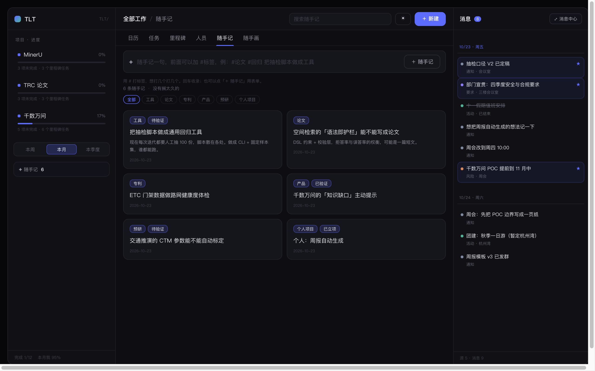
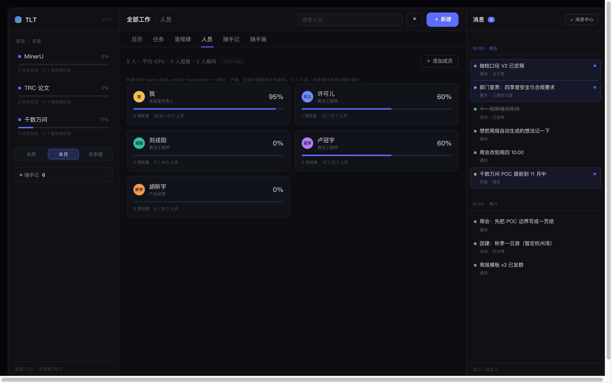
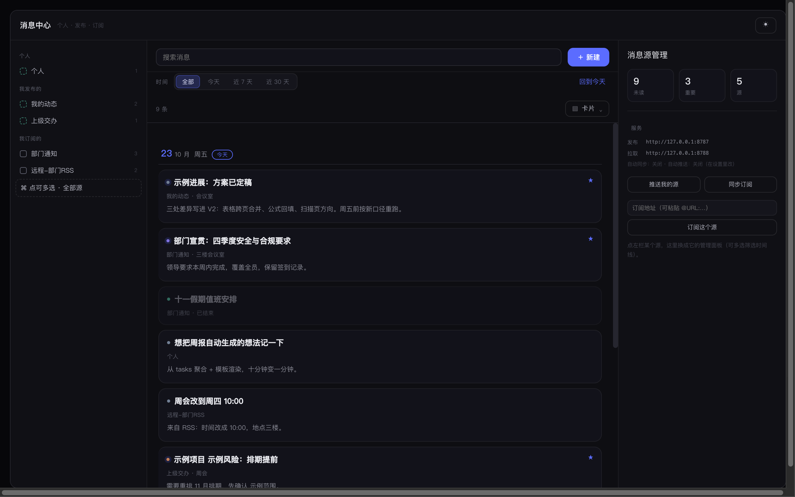
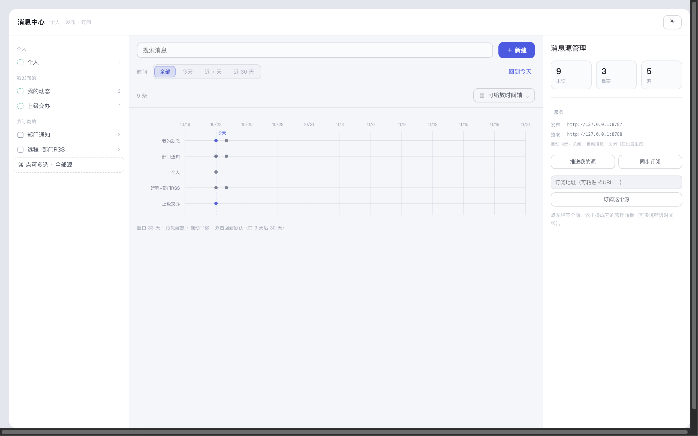
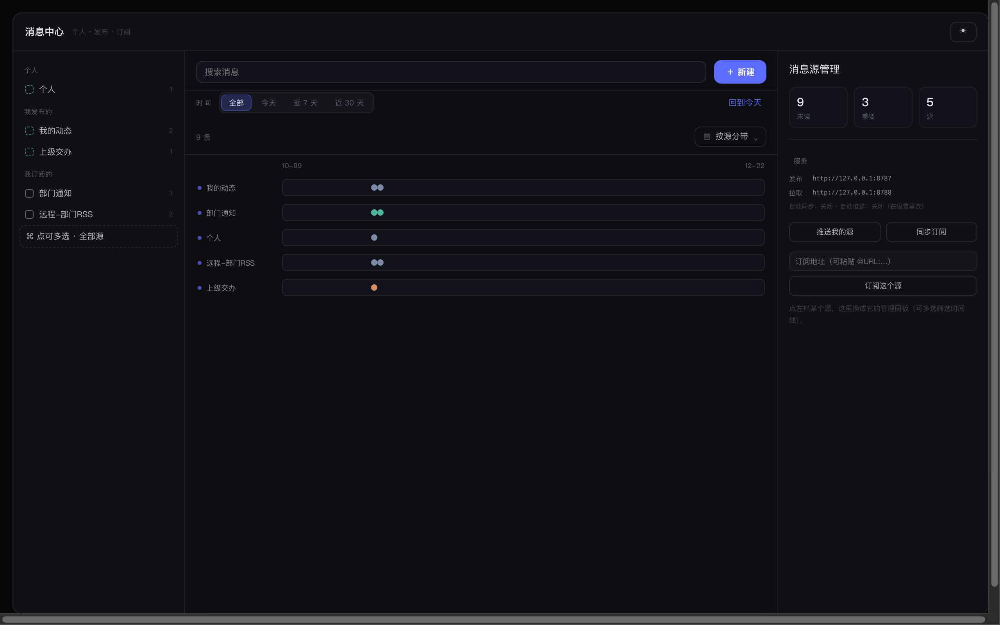
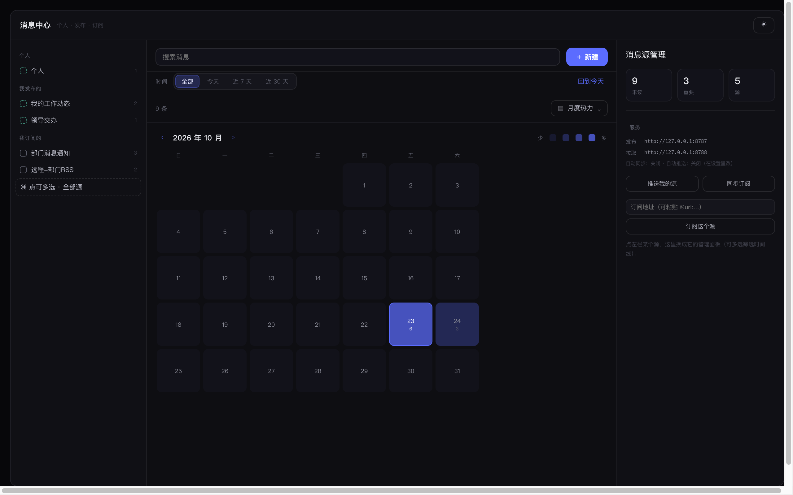
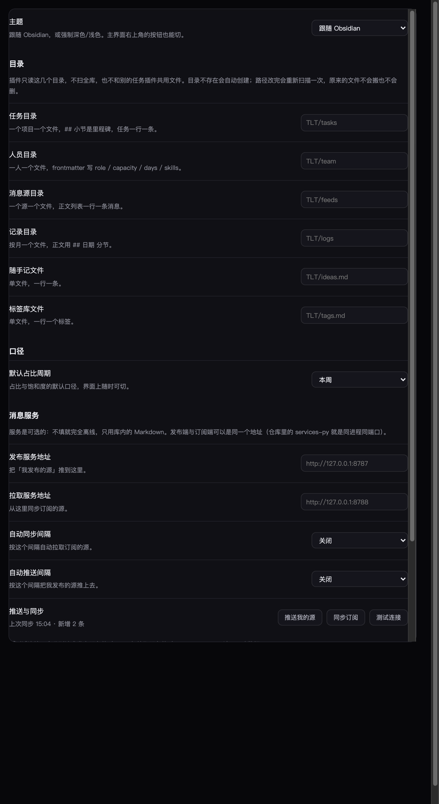

# TLT - Timeline Things · 时间线工作台

**中文** | [English](README.en.md)

**A timeline-first workbench for Obsidian**: calendar, tasks, milestones, team load and quick notes, plus a standalone message center with publishing and subscribing. Everything is stored as plain Markdown in your vault — uninstall the plugin and your data is still there. Full English guide: [README.en.md](README.en.md).

以**时间线**为中心的任务与消息工作台：日历、任务、里程碑、人员饱和度、随手记，外加一个可以单独使用的消息中心。所有内容都是你库里的普通 Markdown —— 删掉插件，数据还在。



## 截图

| 视图 | 看什么 |
| --- | --- |
|  | **任务**：逾期 / 要做 / 已完成 / 待排期分组，可按标签筛 |
|  | **里程碑**：项目里每个 `##` 小节一张卡，展开能直接勾任务 |
|  | **随手记**：一行一条，标签筛选与标签库 |
|  | **人员**：档案 + 饱和度（本期未完成占比 ÷ 产能） |
|  | **消息中心**：左源、中时间线、右管理 |
|  | 形态之一：**可缩放时间轴**（滚轮缩放、拖动平移） |
|  | 形态之一：**按源分带**（一个源一条泳道） |
|  | 形态之一：**月度热力**（颜色深浅 = 当天条数） |
|  | **设置页**：通用项在最上，目录 / 口径 / 消息服务 / 维护分节，每项都写清默认值与影响 |

## 安装

- **BRAT**（测试版）：装 [BRAT](https://github.com/TfTHacker/obsidian42-brat) → *Add beta plugin* → `sxinyuhoo/TLT-timeline-things`
- **手动**：把 `main.js`、`manifest.json`、`styles.css` 放进 `<vault>/.obsidian/plugins/tlt-timeline-things/`，再到 设置 → 第三方插件 启用

首次启用会按需建目录；命令面板里有 **「生成示例数据」**，可以先看效果再上手——示例里的人名、项目、消息全是编的占位内容，已存在的文件不覆盖。

需要 Obsidian **1.8.7+**（桌面端与移动端都可）。界面语言可在设置里选：跟随 Obsidian／中文／English，漏译的条目会回落成中文。

## 它和别的任务插件不一样的地方

1. **以时间线为主轴**，不是以项目树为主轴。打开就是「今天」：几点做了什么、这天还要做什么、临时插进来什么。项目和里程碑是背后的组织方式，不是入口。
2. **不另存数据**。任务写回原笔记那一行（`🛫 📅 [wl::] [owner::] [tags::] [st::] [en::]`），人员写 frontmatter，消息源就是一串列表项。插件卸载了，文件照样能读、能搜、能双链。
3. **消息中心可以独立使用**。它是单独的页面，只订阅消息、不碰任务，给不用任务管理的同事看通知也成立。

## 六个页签

| 页签 | 干什么 |
| --- | --- |
| **日历** | 当天时间轴（记录 + 计划块）、这天要做的、节奏星图（半径=时间，扇区=项目，滚轮缩放） |
| **任务** | 四组（逾期 / 要做 / 已完成 / 待排期）+ 标签筛选，点一条改截止、占比、优先级、负责人 |
| **里程碑** | 一张卡一个里程碑，展开是任务行，能直接勾完成 |
| **人员** | 档案（岗位 / 产能 / 在岗天数 / 技能）+ 饱和度 + 未来四周负载 |
| **随手记** | 一行一条，`#标签` 打标；标签库可增删改，筛选支持多选 |
| **随手画** | 预留位（草稿 / 白板 / 截图批注） |

右侧常驻消息栏，点「⤢ 消息中心」打开独立页。

## 消息中心

左栏选源，中间看消息，右栏管源。

| 源 | 从哪来 | 右栏能做什么 |
| --- | --- | --- |
| **个人** | 自己的草稿 | 新建消息、**发布消息源**（变成别人能订阅的源） |
| **我发布的** | 发布出来的源 | 手动推送、**取消发布**（内容并回个人） |
| **我订阅的** | 别人发布的源 | **取消订阅**（本地文件进回收站） |

七种展现形态：**卡片 / 河流 / 紧凑 / 按源分带 / 可缩放时间轴 / 月度热力 / 人物脉络**。

消息一行文字 + 可选行内字段，5W 都能填：

```
- 2026-10-22 周报模板定稿 [place:: 三楼] [who:: [[示例同事]], [[张三]]] [why:: 下周对口径] [tags:: 周报]
  > 把模板发群里
```

### 发布与订阅

插件不强制任何服务。三种共享方式：

1. 同一个库走 iCloud / 坚果云同步（最省事）
2. 共享库（网盘 / Git）
3. 跑一个消息服务（跨机器、可给部门用）：`services-py/tlt_service.py`，单进程、单文件、零依赖

```bash
python3 services-py/tlt_service.py --port 8787 --data ./data --seed
```

发布端与订阅端同进程同端口，插件设置里两个地址都填 `http://服务器:8787`。支持本项目 JSON、**RSS 2.0**、**Atom**。

## 数据放在哪

| 路径 | 内容 |
| --- | --- |
| `TLT/tasks/<项目>.md` | 任务：一个项目一个文件，`##` 是里程碑，一行一条任务 |
| `TLT/crew/<姓名>.md` | 人员：frontmatter 存 `role / capacity / days / skills` |
| `TLT/feeds/<源名>.md` | 消息源：一行一条消息 |
| `TLT/logs/<YYYY-MM>.md` | 记录：`## 日期` 分节，时间块 + 正文 |
| `TLT/ideas.md` | 随手记：一行一条 |
| `TLT/tags.md` | 标签库：一行一个 |

字段级格式见 [docs/data-format.md](docs/data-format.md)。

六个路径默认都在库根目录的 `TLT/` 下；**根目录可在设置里改**——它表示「TLT 目录放在哪」，改完点旁边的「更新」重建六项并创建目录（旧目录里还有文件时会问你要不要一起搬）。

## 命令

| 命令 | 作用 |
| --- | --- |
| 打开工作台 | 主界面 |
| 打开消息中心（独立页） | 只用消息时开这个 |
| 新建任务 | 快速加一条 |
| 生成示例数据 | 在 `TLT/` 下写样例（已存在的不覆盖） |
| 切换明暗 | 在深色 / 浅色之间切 |
| 推送到发布服务 / 从拉取服务同步 | 手动同步消息 |

## 隐私与网络

- 只在**你自己配置了消息服务**时才发请求，地址由你填；不配置就完全离线。
- 没有遥测、没有统计、不上传内容。
- 服务地址与发布 ID 存在插件自己的 `data.json` 里。

## 已知边界

- 时间轴不支持拖拽改时间（点击块改时间）。
- 重复任务（`🔁`）不解析。
- 「已读」只在本次会话内，不写回文件。
- 消息的「推送」是整源覆盖，不做增量 diff。

## 开发

```bash
npm install
npm run build      # 产出 main.js
npm test           # 数据层 + 渲染冒烟
npm run test:all   # 含源生命周期、RSS、Python 服务、Hub 端到端
npm run preview    # 导出各视图静态 HTML，用于看样式
```

- TypeScript + esbuild（CJS）；测试用 jsdom + 桩件跑真实渲染。
- 交互验证：`npm run play` 生成能在浏览器里真点的测试台，`npm run serve` 起静态服务。

## 路线图

见 [ROADMAP.md](ROADMAP.md)。下一步是**日历互操作**（导入 macOS 日历 / `.ics`，双向同步）。

## 许可

MIT
